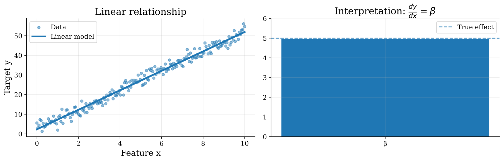
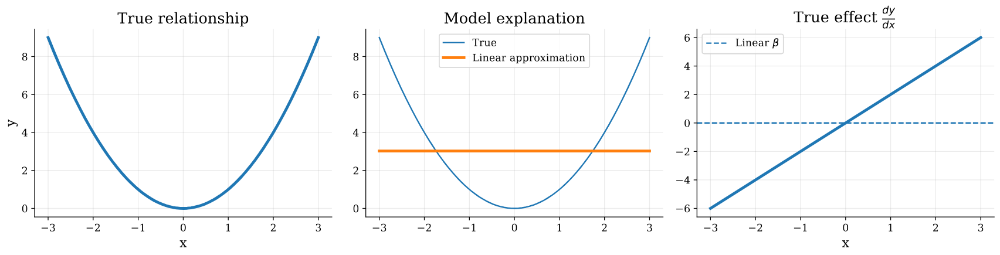
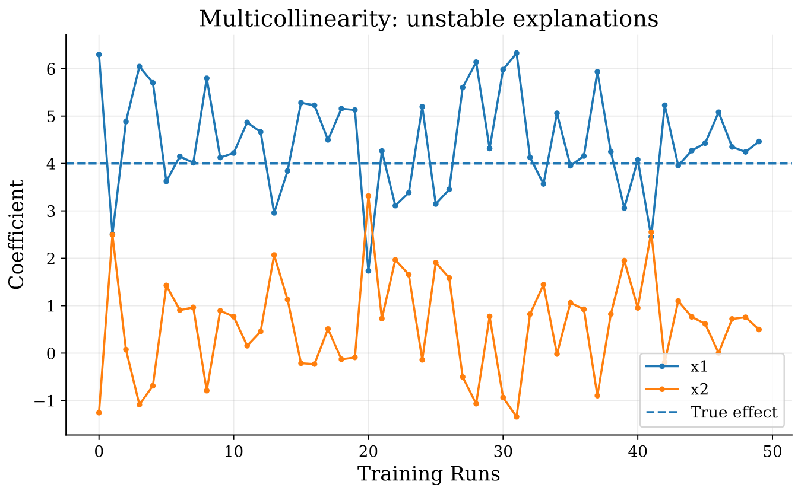

# Basics of Machine Learning

Machine learning is a fundamental component of artificial intelligence where algorithms learn patterns from data to make predictions on new tasks. In supervised learning, a model is trained using input features and corresponding target values, with the objective of learning a relationship that generalizes beyond the training data. The following sections introduce commonly used supervised learning algorithms, their mathematical formulations, and the assumptions and/or limitations associated with each model.

## Linear Regression

Linear regression represents the output variable $y$ as a linear combination of the input features $\mathbf{X}$ weighted by the scaling coefficient matrix $\boldsymbol{\beta}$.
Mathematically:$$\mathbf{y} = \mathbf{X}\boldsymbol{\beta} + \boldsymbol{\varepsilon},$$
$$\mathbf{X} \in \mathbb{R}^{n \times p}, \quad \mathbf{y} \in \mathbb{R}^{n}, \quad \boldsymbol{\beta} \in \mathbb{R}^{p}, \quad \boldsymbol{\varepsilon} \in \mathbb{R}^{n}.$$where $\boldsymbol{\varepsilon}$ is called the irreducible error term, it is typically considered a random variable with zero mean and constant variance. It captures the noise, and the variations in the data that the model failed to explain using the given features, $n$ is the number of training instances, and $p$ is the number of features.

We can run iterative optimization using standard gradient descent algorithm [@ruder2017overviewgradientdescentoptimization] to find the betas that minimize mean squared error (MSE):$$J(\boldsymbol{\beta}) = \frac{1}{2n} \left\Vert{} \mathbf{y} - \mathbf{X}\boldsymbol{\beta} \right\Vert{}_2^2.$$
$$\boldsymbol{\beta}^{(t+1)} = \boldsymbol{\beta}^{(t)} - \eta \frac{1}{n} \mathbf{X}^{\top} (\mathbf{X}\boldsymbol{\beta}^{(t)}-\mathbf{y}),$$
$$\frac{\partial y}{\partial x_j} = \boldsymbol{\beta}_j,$$

Linear Regression models are inherently interpretable through their coefficient vector $\boldsymbol{\beta}$. Each coefficient $\beta_j$ quantifies the effect of the corresponding feature represented by the $j$-th column of the feature matrix $\mathbf{X}$ as shown in @fig-linear-interpretability.

{#fig-linear-interpretability width=85%}

While Linear Regression is simple, and interpretable by design, many limitations rise from the implicit inductive biases assumed by this model [@wang2025tutorialregressionanalysislinear]. First, Linear Regression models assumes a linear relationship between the input features and the target variable if the relation is not linear the learned coefficient fails to explain the effect of the feature as shown in @fig-nonlinear-interpretability, more formally:
$$\frac{\partial y}{\partial x_j} \neq \boldsymbol{\beta}_j,$$

{#fig-nonlinear-interpretability width=85%}

Also, Linear Regression models assumes independence between features. Feature correlation can be reflected in the Gram matrix $\mathbf{X}^{\top}\mathbf{X}$, where off-diagonal elements quantify the similarity between feature columns. Strong correlations between features introduce multicollinearity, making the estimated coefficients $\boldsymbol{\beta}$ unstable and reduces interpretability as shown in @fig-multicollinearity.

{#fig-multicollinearity width=85%}

## Logistic Regression

Logistic regression is a supervised machine learning algorithm used for classification, despite the name leading one to believe it would predict continuous values (regression). Logistic regression predicts the probability that an input belongs to a class by passing a weighted sum of the input features through a sigmoid function. 

::: {.callout-note title="Running example: restaurant recommendation"}
Throughout the logistic regression section, we will use a running example of a logistic regression model that predicts whether a customer will recommend a resturant based on a number of factors, including food rating, waiting time, and price. For a visit *“The pasta was excellent (5 stars), we waited 60 minutes, and paid \$30 per person,”* the model should combine a strong positive signal (food) with negative signals (a long wait and the price) and output a probability that the customer recommends the restaurant.
:::

Logistic regression makes a prediction in three steps: 

$$
\mathbf{x}
\xrightarrow{\;\text{linear score}\;}
z
\xrightarrow{\;\sigma\;}
\widehat{p}
\xrightarrow{\;\text{threshold}\;}
\widehat{y}.
$$ {#eq-lr-pipeline}

The model starts by computing a single real-valued score $z$ from the aforementioned input features. The sigmoid function $\sigma$ converts this real-valued score into a probability $\widehat{p}$, which is then thresholded to produce a binary classification prediction $\widehat{y}$. 

In the running example, $\mathbf{x}$ consists of the three input features, which the model uses to compute a score and converts the score into a recommendation probability, which will then predict *recommend* if the probability is above a threshold (e.g., 0.5) and *not recommend* otherwise.

### Features and the importance of linear scoring 

If $d$ is the number of features, the input is a feature vector

$$
\mathbf{x}
=
(x_1,\ldots,x_d),
$$

where $x_j$ denotes the value of feature $j$. The model has one weight $w_j$ for each feature and a bias $b$. Combining them into a linear score;

$$
z
=
\mathbf{w}^\top\mathbf{x}+b
=
b+\sum_{j=1}^{d}w_j x_j.
$$ {#eq-lr-linear-score}

The score $z\in\mathbb{R}$ is referred to as the *logit*. Logits are large values that when positive, favour the positive class, and when negative, favour the negative class. Going back to our running example of the resturant, the logit is

$$
z
=
b
+w_{\mathrm{food}}x_{\mathrm{food}}
+w_{\mathrm{wait}}x_{\mathrm{wait}}
+w_{\mathrm{price}}x_{\mathrm{price}}.
$$ {#eq-lr-restaurant-score}

### Obtaining probabilities from scores

A probability is a value between 0 and 1, but the logit can be any real value. The sigmoid, or logistic, function maps the logit to a range:

$$
\widehat{p}
=
p(y=1\mid\mathbf{x})
=
\sigma(z)
=
\frac{1}{1+e^{-z}}.
$$ {#eq-lr-sigmoid}

Some properties of sigmoid include: 

| Property | Meaning |
|---|---|
| $\sigma(0)=0.5$ | A logit of zero means the model is undecided |
| $\sigma(-z)=1-\sigma(z)$ | The function is symmetric around $z=0$ |
| $\sigma'(z)=\sigma(z)\bigl(1-\sigma(z)\bigr)$ | The slope is largest at $z=0$ and shrinks toward 0 and 1 |

Combining @eq-lr-linear-score and @eq-lr-sigmoid gives the full model:

$$
\widehat{p}
=
\sigma\!\left(\mathbf{w}^\top\mathbf{x}+b\right).
$$ {#eq-lr-model}

Suppose the trained model has the parameters

$$
b=-2.0,\qquad
w_{\mathrm{food}}=1.2,\qquad
w_{\mathrm{wait}}=-0.04,\qquad
w_{\mathrm{price}}=-0.01.
$$

For the running review, $x_{\mathrm{food}}=5$, $x_{\mathrm{wait}}=60$, and $x_{\mathrm{price}}=30$. The logit is

$$
z
=
-2.0+1.2(5)-0.04(60)-0.01(30)
=
-2.0+6.0-2.4-0.3
=
1.3,
$$

with the recommendation probability being $\sigma(1.3)\approx 0.79$.

### Log-odds

The *odds* of the positive class is the ratio $\widehat{p}/(1-\widehat{p})$. For example, a probability of 0.8 would correspond to odds of 4:1, meaning that the positive class if four times more likely than the negative class. Inverting @eq-lr-sigmoid would show that the logit measures:

$$
\log\frac{\widehat{p}}{1-\widehat{p}}
=
\mathbf{w}^\top\mathbf{x}+b.
$$ {#eq-lr-log-odds}

By this logic, logistic regression is a linear model of the log-odds, meaning the model is linear in the logit and not the probability. 

### Making decisions through probabilities

To create a class label, a probability is compared with a threshold $t$:

$$
\widehat{y}
=
\begin{cases}
1, & \widehat{p}\ge t,\\
0, & \widehat{p}<t.
\end{cases}
$$ {#eq-lr-decision}

The threshold should not be learned from the likelihood and should instead be chosen according to the relative costs of the false positives and false negatives. In our running example, $\widehat{p}\approx 0.79\ge 0.5$, so the model will predict recommend. 

### What if there is more than two classes?

A multinomial logistic regression learns one weight vector $\mathbf{w}_r$ and bias $b_r$ for each class $R$, and calculates one logit per class. Softmax then converts the logits into class probabilities that sum to 1;

$$
p(y=r\mid\mathbf{x})
=
\frac{\exp(z_r)}
{\displaystyle\sum_{q=1}^{R}\exp(z_q)},
\qquad r=1,\ldots,R.
$$ {#eq-lr-softmax}

Adding the same vectr to every $\mathbf{w}_r$ leaves the probabilities unchanges, meaning one class can be fixed as a reference with zero weights. So, if $R=2$, @eq-lr-softmax reduces to the sigmoid model in @eq-lr-model.

### Evaluation of logistic regression

Given the fact that models can achieve high accuracy on an imbalanced datatset by predicting only the majority class, the following metrics are can provide a more comprehensive evaluation of the model's performance, beyond accuracy:

- **Classification performance:** how often $\widehat{y}$ matches the label. Accuracy, precision, recall, and F1 all depend on the threshold $t$, so the threshold used should be reported.
- **Ranking performance:** whether positive examples receive higher probabilities than negative examples, regardless of threshold. The area under the ROC curve (ROC-AUC) measures this. 
- **Coefficient stability:** whether the weights stay similar across resamples of the training data. This is because unstable weights indicate that individual coefficients should be dealth with cautiously, even if predictions are accurate.

### Limitations and use cases of logistic regression

- **Linear decision boundary:** the model cannot represent nonlinear relationships unless they are supplied with manually made features, such as interactions or polynomial terms.
- **Raw, unstructured inputs:** on images, audio, or text represented as raw pixels or tokens, individual features carry little meaning on their own and a linear boundary is not truly sufficient.
- **Correlated features:** individual weights become unstable and can be misread, even when predictions are accurate.
- **Class imbalance:** with a rare positive class, the default threshold of 0.5 can yield few or no positive predictions, and so, the threshold should be adjusted.

::: {.callout-tip title="Key takeaway"}
Logistic regression models the log-odds of a class as a weighted sum of the input features and converts it into a probability with the sigmoid function, with each weight stating how a change in a feature shifts the log-odds. 
:::

## Decision Trees

Decision trees are supervised machine learning algorithms used for both classification and regression. They make predictions by repeatedly splitting data into smaller groups based on feature values, creating a tree-like structure of decision rules. Each internal node represents a decision about a feature, each branch represents a possible outcome, and each leaf node provides the final prediction.

Tree-based learning algorithms use different criteria to determine how the data should be split. For example, ID3 uses information gain to select a split [@Quinlan1986ID3], while CART can use Gini impurity for classification [@breiman1984cart]. By introducing feature-dependent thresholds and successive splits, decision trees can represent nonlinear relationships in the data [@molnar2025].

For example, a decision tree predicting whether a student will pass an exam might consider study hours, attendance, and previous grades. The model reaches its prediction by following a sequence of decisions from the root node to a leaf. However, deeper trees can overfit the training data and struggle to generalize to new observations. As tree depth increases, the number of decision rules also grows, creating a trade-off between predictive performance and the ease with which a person can understand the full tree [@molnar2025].

## K-Nearest Neighbors

K-Nearest Neighbors (KNN) is a supervised machine learning algorithm used for classification and regression. Rather than learning a fixed set of coefficients, KNN stores the training data and makes predictions by comparing a new observation with existing examples. It identifies the $K$ closest data points using a distance metric, such as Euclidean distance.

For classification, the most common class among the neighboring observations becomes the prediction, while regression typically uses the average of their target values. For example, if a new observation's five nearest neighbors include three cats and two dogs, KNN would classify it as a cat. The choice of $K$ is important because smaller values can be sensitive to noise, while larger values may overlook local relationships.

# Basics of Explainable AI

Explainable artificial intelligence (XAI) are methods for understanding how models make predictions and which factors contribute to their decisions [@arrieta2019explainableartificialintelligencexai;@molnar2025]. Explainability describes the reasoning and evidence that can be presented to help a person understand model behavior.

Explainability methods can be distinguished by whether interpretability is provided by the model itself or through an additional explanation, resulting in **intrinsic** and **post-hoc** approaches. They can also be categorized as **global** or **local**, and as **model-agnostic** or **model-specific**, according to their dependence on a model's internal architecture.

## Intrinsic vs. Post-Hoc Methods

### Intrinsic Interpretability

Intrinsic interpretability refers to models whose internal structure is sufficiently understandable to provide an explanation of how a prediction is produced. These models are often comparatively simple, with parameters or decision rules that can be inspected directly [@molnar2025]. Linear regression, logistic regression, generalized linear models (GLMs) [@wang2025tutorialregressionanalysislinear], and appropriately sized decision trees are examples of models that can be interpretable by design [@MILLER20191;@molnar2025].

For linear regression, the learned coefficient vector $\boldsymbol{\beta}$ provides a direct means of interpreting the model. Under the specified linear model, each coefficient $\beta_j$ measures the change in the predicted output associated with a one-unit increase in feature $x_j$, holding the remaining features constant:

$$
\frac{\partial \widehat{y}}{\partial x_j}=\beta_j.
$$

As shown in @fig-linear-interpretability, the coefficient corresponds to a constant marginal effect when a linear relationship adequately describes the underlying data.

{#fig-linear-interpretability width=85%}

However, the reliability of coefficient-based explanations depends on the model specification and the relationships among the features. When the underlying relationship is nonlinear, the true effect of a feature may vary across input values, rather than remaining equal to a single constant coefficient as illustrated in @fig-nonlinear-interpretability. Strong multicollinearity can also cause learned coefficients to vary across training samples, making it difficult to associate a stable interpretation with each coefficient, as illustrated in @fig-multicollinearity [@Hastie+al:2009].

Logistic regression is similarly interpretable through its weights, although the coefficients represent changes in the **log-odds** rather than direct changes in the predicted probability. As shown in @eq-lr-log-odds, increasing feature $x_j$ by one unit changes the model's log-odds by $w_j$, holding the other features constant.

Decision trees provide a different form of intrinsic interpretability. A prediction can be traced from the root to a leaf as a sequence of human-readable *if-else* decision rules. However, when a tree becomes very deep, this sequence and the model's overall structure can be more difficult to understand. Thus, even intrinsically interpretable models may exhibit a trade-off between model complexity and practical interpretability [@molnar2025].

### Post-Hoc Explainability

Post-hoc methods generate explanations after a model has been trained, without requiring that the underlying model be interpretable by design. They are commonly applied to more complex, black-box models to help explain which inputs or internal representations contribute to a prediction [@arrieta2019explainableartificialintelligencexai;@molnar2025]. Unlike intrinsic models, a post-hoc explanation is a separate representation of model behavior and may not perfectly capture the model's actual decision process.

Some post-hoc methods are **model-agnostic**. For example, LIME [@ribeiro2016whyitrustyou] uses local perturbations to approximate the behavior of a model around a particular input, while SHAP [@lundberg2017unifiedapproachinterpretingmodel] provides feature attributions based on Shapley-value principles. Other methods are **model-specific** and depend on a model's architecture. In neural networks, these include approaches that inspect attention patterns in transformer models and gradient-based methods that measure how model outputs change in response to changes in the input.

In image classification, Saliency Maps [@simonyan2014deepinsideconvolutionalnetworks], Class Activation Maps (CAM) [@minh2023overviewclassactivationmaps], and variants such as Grad-CAM [@Selvaraju_2019] can be used to generate spatial explanations that highlight image regions associated with a particular predicted class. These methods help visualize what regions influence the model's output, although the resulting heat maps should not automatically be treated as complete explanations of the model's reasoning.

## Global vs. Local Explainability

Explainability methods can be categorized according to the scope of the behavior they aim to describe. **Global explainability** focuses on understanding a model's overall behavior, including which features are generally important and how they influence predictions across a dataset. For example, a global explanation of a loan approval model might reveal that income and credit history are among the most influential features across many applications.

**Local explainability**, on the other hand, focuses on understanding why a model made a particular prediction for a specific observation. For example, a local explanation might show that an individual's loan application was rejected primarily because of a high debt-to-income ratio.

Overall, global explainability helps us understand the model as a whole, while local explainability helps us understand individual decisions. The two approaches answer different questions and can be used together to provide a more complete picture of model behavior.

## Model-Agnostic vs. Model-Specific Methods

Explainability methods can also be categorized according to whether they depend on a model's internal architecture. **Model-agnostic methods** can be applied to many different machine learning models because they primarily examine the relationship between inputs and outputs, without requiring detailed access to the model's internal structure. Examples include LIME and model-agnostic implementations of SHAP.

In contrast, **model-specific methods** are designed for particular model families or use their internal structures to generate explanations. Examples include interpreting coefficients in logistic regression, tracing decision paths in decision trees, and generating gradient-based saliency maps for neural networks.

The key distinction is that model-agnostic methods provide greater flexibility across different algorithms, while model-specific methods can make use of a model's structure to generate more specialized explanations. These categories describe a different dimension from intrinsic versus post-hoc interpretability: a method can be both post-hoc and model-specific, as is the case with Grad-CAM.

## Practical Considerations

### Selecting an Explainability Method

### Evaluating Explanations

#### Fidelity

#### Robustness

#### Stability

#### Human Interpretability

### Common Pitfalls

### Best Practices

### Summary

