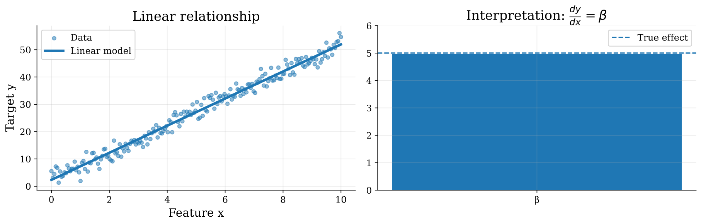
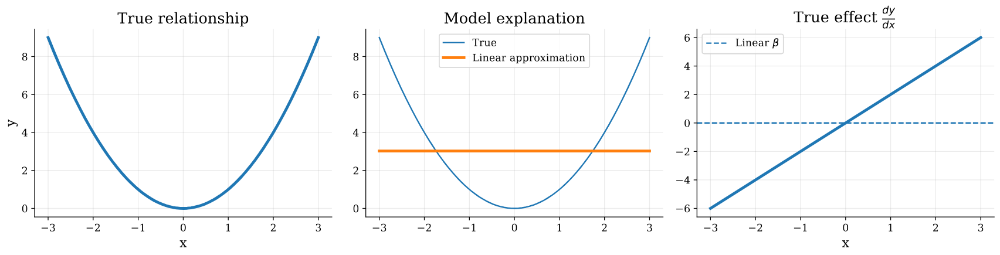
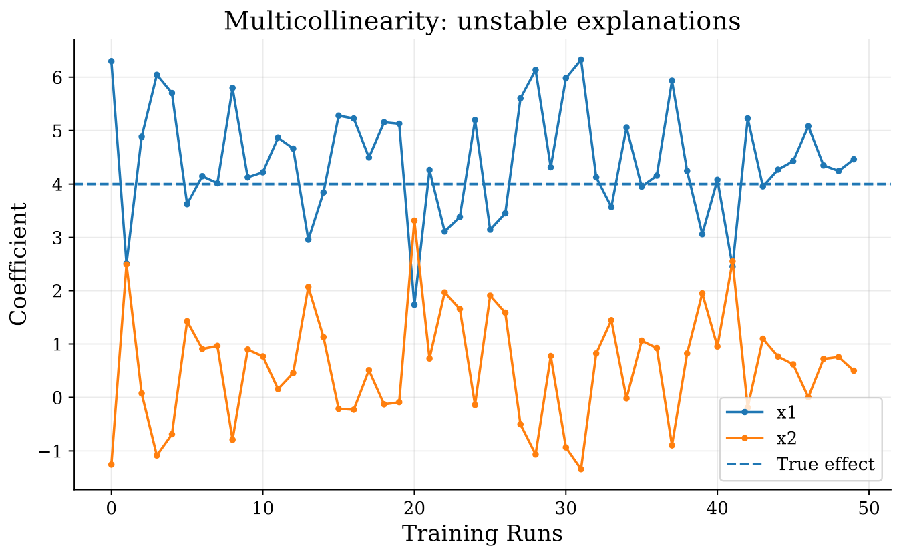

# Introduction

(This section was previously called: "Categorization of XML Methods")

There are many taxonomies in which interpretability methods can be categorized, they can be categorized according to the nature of the learning algorithm or the stage at which the model becomes interpretable into Intrinsic and Post-Hoc methods, They can also be categorized into Local and Global methods according to the scope of explanations.

## Intrinsic vs. Post-Hoc Methods

Intrinsic methods indicate that the model itself is inherently interpretable, and by design, the algorithm itself tends to be less complex and the factors affecting the decision making process are always disentangled [@molnar2025]. Linear Regression, Logistic Regression, Generalized linear models (GLMs) [@wang2025tutorialregressionanalysislinear] and Decision Trees are examples of models that are interpretable by design; they either show the importance of each feature, or come up with human readable decision rules [@MILLER20191;@molnar2025]. While these models are simple, efficient, and interpretable, they face many limitations when deployed to the real world. For example, linear models can be interpreted by measuring the feature importance, or by looking into the coefficient of each feature in the weight matrix [@molnar2025]. However linear models are built on very strict assumptions and inductive biases such as linearity, independence, and absence of heteroscedasticity which are difficult to gurantee in the real world [@Hastie+al:2009], thus limiting the ability of such algorithms to capture true, non-linear patterns underlying the data or even model complex high dimensional data which limits the predictive performance of such models. 

While linear models fail to model non-linear data, tree-based models come into play. They work by splitting the data multiple times according to discovered thresholds over the values of the features [@molnar2025]. Each learning algorithm uses a different criterion to grow the optimal tree. For example, ID3 measures the Information Gain criterion to find the best splits [@Quinlan1986ID3], While CART optimizes for the Gini Impurity  [@breiman1984cart]. All tree based algorithms are capable of modeling non-linear data. Those models are Interpretable intrinsically; you can traverse the tree starting from the root to the leaf in order to find the decision in the form of sequential If-Else statements. However, due to the greedy nature of the learning algorithm it tends to increase the depth of the tree drastically leading to a trade-off between error minimization and being easily interpretable [@molnar2025].

On the other hand, Post-Hoc methods work by reporting how an already trained model produces its predictions, For any given input it tries to provide understandable explanations for the learned decision boundaries by the more complex black-box models [@arrieta2019explainableartificialintelligencexai,@molnar2025]. Post-Hoc methods can be categorized into two main categories: Model-Agnostic methods, and model model-specific methods [@arrieta2019explainableartificialintelligencexai], Where the former can be plugged into any model to explain its decision space, e.g perturbation based approaches like LIME [@ribeiro2016whyitrustyou] and SHAP [@lundberg2017unifiedapproachinterpretingmodel] that predict how the decision space changes when the input data point is perturbed, While the latter is specific to a model architecture like analyzing attention maps in transformer networks, or gradient-based methods that look into the gradient of the input with respect to the loss function to provide pixel-level explanations like Saliency Maps [@simonyan2014deepinsideconvolutionalnetworks], class activation maps (CAM) [@minh2023overviewclassactivationmaps] and it varients like GradCAMs [@Selvaraju_2019] in convolutional neural networks (CNNs) are also used to quantify the amount of input activation conditioned on the output class to provide a heat-map for the relevant regions for the predicted class.

### Linear Regression

Linear regression represents the output variable $y$ as a linear combination of the input features $\mathbf{X}$ weighted by the scaling coefficient matrix $\boldsymbol{\beta}$.
Mathematically:$$\mathbf{y} = \mathbf{X}\boldsymbol{\beta} + \boldsymbol{\varepsilon},$$
$$\mathbf{X} \in \mathbb{R}^{n \times p}, \quad \mathbf{y} \in \mathbb{R}^{n}, \quad \boldsymbol{\beta} \in \mathbb{R}^{p}, \quad \boldsymbol{\varepsilon} \in \mathbb{R}^{n}.$$where $\boldsymbol{\varepsilon}$ is called the irreducible error term, it is typically considered a random variable with zero mean and constant variance. It captures the noise, and the variations in the data that the model failed to explain using the given features, $n$ is the number of training instances, and $p$ is the number of features.

We can run iterative optimization using standard gradient descent algorithm [@ruder2017overviewgradientdescentoptimization] to find the betas that minimize mean squared error (MSE):$$J(\boldsymbol{\beta}) = \frac{1}{2n} \left\Vert{} \mathbf{y} - \mathbf{X}\boldsymbol{\beta} \right\Vert{}_2^2.$$
$$\boldsymbol{\beta}^{(t+1)} = \boldsymbol{\beta}^{(t)} - \eta \frac{1}{n} \mathbf{X}^{\top} (\mathbf{X}\boldsymbol{\beta}^{(t)}-\mathbf{y}),$$
$$\frac{\partial y}{\partial x_j} = \boldsymbol{\beta}_j,$$

Linear Regression models are inherently interpretable through their coefficient vector $\boldsymbol{\beta}$. Each coefficient $\beta_j$ quantifies the effect of the corresponding feature represented by the $j$-th column of the feature matrix $\mathbf{X}$ as shown in @fig-linear-interpretability.

{#fig-linear-interpretability width=85%}

While Linear Regression is simple, and interpretable by design, many limitations rise from the implicit inductive biases assumed by this model [@wang2025tutorialregressionanalysislinear]. First, Linear Regression models assumes a linear relationship between the input features and the target variable if the relation is not linear the learned coefficient fails to explain the effect of the feature as shown in @fig-nonlinear-interpretability, more formally:
$$\frac{\partial y}{\partial x_j} \neq \boldsymbol{\beta}_j,$$

{#fig-nonlinear-interpretability width=85%}

Also, Linear Regression models assumes independence between features. Feature correlation can be reflected in the Gram matrix $\mathbf{X}^{\top}\mathbf{X}$, where off-diagonal elements quantify the similarity between feature columns. Strong correlations between features introduce multicollinearity, making the estimated coefficients $\boldsymbol{\beta}$ unstable and reduces interpretability as shown in @fig-multicollinearity.

{#fig-multicollinearity width=85%}

### Logistic Regression

Logistic regression is a supervised machine learning algorithm used for classification, despite the name leading one to believe it would predict continuous values (regression). Logistic regression predicts the probability that an input belongs to a class by passing a weighted sum of the input features through a sigmoid function. 

::: {.callout-note title="Running example: restaurant recommendation"}
Throughout the logistic regression section, we will use a running example of a logistic regression model that predicts whether a customer will recommend a resturant based on a number of factors, including food rating, waiting time, and price. For a visit *“The pasta was excellent (5 stars), we waited 60 minutes, and paid \$30 per person,”* the model should combine a strong positive signal (food) with negative signals (a long wait and the price) and output a probability that the customer recommends the restaurant.
:::

## Model and inference 

Logistic regression makes a prediction in three steps: 

$$
\mathbf{x}
\xrightarrow{\;\text{linear score}\;}
z
\xrightarrow{\;\sigma\;}
\widehat{p}
\xrightarrow{\;\text{threshold}\;}
\widehat{y}.
$$ {#eq-lr-pipeline}

The model starts by computing a single real-valued score $z$ from the aforementioned input features. The sigmoid function $\sigma$ converts this real-valued score into a probability $\widehat{p}$, which is then thresholded to produce a binary classification prediction $\widehat{y}$. 

In the running example, $\mathbf{x}$ consists of the three input features, which the model uses to compute a score and converts the score into a recommendation probability, which will then predict *recommend* if the probability is above a threshold (e.g., 0.5) and *not recommend* otherwise.

### Features and the importance of linear scoring 

If $d$ is the number of features, the input is a feature vector

$$
\mathbf{x}
=
(x_1,\ldots,x_d),
$$

where $x_j$ denotes the value of feature $j$. The model has one weight $w_j$ for each feature and a bias $b$. Combining them into a linear score;

$$
z
=
\mathbf{w}^\top\mathbf{x}+b
=
b+\sum_{j=1}^{d}w_j x_j.
$$ {#eq-lr-linear-score}

The score $z\in\mathbb{R}$ is referred to as the *logit*. Logits are large values that when positive, favour the positive class, and when negative, favour the negative class. Going back to our running example of the resturant, the logit is

$$
z
=
b
+w_{\mathrm{food}}x_{\mathrm{food}}
+w_{\mathrm{wait}}x_{\mathrm{wait}}
+w_{\mathrm{price}}x_{\mathrm{price}}.
$$ {#eq-lr-restaurant-score}

### Obtaining probabilities from scores

A probability is a value between 0 and 1, but the logit can be any real value. The sigmoid, or logistic, function maps the logit to a range:

$$
\widehat{p}
=
p(y=1\mid\mathbf{x})
=
\sigma(z)
=
\frac{1}{1+e^{-z}}.
$$ {#eq-lr-sigmoid}

Some properties of sigmoid include: 

| Property | Meaning |
|---|---|
| $\sigma(0)=0.5$ | A logit of zero means the model is undecided |
| $\sigma(-z)=1-\sigma(z)$ | The function is symmetric around $z=0$ |
| $\sigma'(z)=\sigma(z)\bigl(1-\sigma(z)\bigr)$ | The slope is largest at $z=0$ and shrinks toward 0 and 1 |

Combining @eq-lr-linear-score and @eq-lr-sigmoid gives the full model:

$$
\widehat{p}
=
\sigma\!\left(\mathbf{w}^\top\mathbf{x}+b\right).
$$ {#eq-lr-model}

Suppose the trained model has the parameters

$$
b=-2.0,\qquad
w_{\mathrm{food}}=1.2,\qquad
w_{\mathrm{wait}}=-0.04,\qquad
w_{\mathrm{price}}=-0.01.
$$

For the running review, $x_{\mathrm{food}}=5$, $x_{\mathrm{wait}}=60$, and $x_{\mathrm{price}}=30$. The logit is

$$
z
=
-2.0+1.2(5)-0.04(60)-0.01(30)
=
-2.0+6.0-2.4-0.3
=
1.3,
$$

with the recommendation probability being $\sigma(1.3)\approx 0.79$.

### Log-odds

The *odds* of the positive class is the ratio $\widehat{p}/(1-\widehat{p})$. For example, a probability of 0.8 would correspond to odds of 4:1, meaning that the positive class if four times more likely than the negative class. Inverting @eq-lr-sigmoid would show that the logit measures:

$$
\log\frac{\widehat{p}}{1-\widehat{p}}
=
\mathbf{w}^\top\mathbf{x}+b.
$$ {#eq-lr-log-odds}

By this logic, logistic regression is a linear model of the log-odds, meaning the model is linear in the logit and not the probability. 

### Making decisions through probabilities

To create a class label, a probability is compared with a threshold $t$:

$$
\widehat{y}
=
\begin{cases}
1, & \widehat{p}\ge t,\\
0, & \widehat{p}<t.
\end{cases}
$$ {#eq-lr-decision}

The threshold should not be learned from the likelihood and should instead be chosen according to the relative costs of the false positives and false negatives. In our running example, $\widehat{p}\approx 0.79\ge 0.5$, so the model will predict recommend. 

### What if there is more than two classes?

A multinomial logistic regression learns one weight vector $\mathbf{w}_r$ and bias $b_r$ for each class $R$, and calculates one logit per class. Softmax then converts the logits into class probabilities that sum to 1;

$$
p(y=r\mid\mathbf{x})
=
\frac{\exp(z_r)}
{\displaystyle\sum_{q=1}^{R}\exp(z_q)},
\qquad r=1,\ldots,R.
$$ {#eq-lr-softmax}

Adding the same vectr to every $\mathbf{w}_r$ leaves the probabilities unchanges, meaning one class can be fixed as a reference with zero weights. So, if $R=2$, @eq-lr-softmax reduces to the sigmoid model in @eq-lr-model.

### Evaluation of logistic regression

Given the fact that models can achieve high accuracy on an imbalanced datatset by predicting only the majority class, the following metrics are can provide a more comprehensive evaluation of the model's performance, beyond accuracy:

- **Classification performance:** how often $\widehat{y}$ matches the label. Accuracy, precision, recall, and F1 all depend on the threshold $t$, so the threshold used should be reported.
- **Ranking performance:** whether positive examples receive higher probabilities than negative examples, regardless of threshold. The area under the ROC curve (ROC-AUC) measures this. 
- **Coefficient stability:** whether the weights stay similar across resamples of the training data. This is because unstable weights indicate that individual coefficients should be dealth with cautiously, even if predictions are accurate.

### Limitations and use cases of logistic regression

- **Linear decision boundary:** the model cannot represent nonlinear relationships unless they are supplied with manually made features, such as interactions or polynomial terms.
- **Raw, unstructured inputs:** on images, audio, or text represented as raw pixels or tokens, individual features carry little meaning on their own and a linear boundary is not truly sufficient.
- **Correlated features:** individual weights become unstable and can be misread, even when predictions are accurate.
- **Class imbalance:** with a rare positive class, the default threshold of 0.5 can yield few or no positive predictions, and so, the threshold should be adjusted.

::: {.callout-tip title="Key takeaway"}
Logistic regression models the log-odds of a class as a weighted sum of the input features and converts it into a probability with the sigmoid function, with each weight stating how a change in a feature shifts the log-odds. 
:::

### Decision Trees

Decision trees are also supervised machine learning algorithms, but are used for both classification and regression tasks. Decision trees make predictions by repeatedly splitting data into smaller groups based on feature values, creating a tree-like structure of decision rules. Each internal node represents a decision about a feature, each branch represents a possible outcome, and each leaf node gives the final prediction. For example, a decision tree predicting whether a student will pass an exam might consider previous behaviour such as study hours, attendance, and previous grades. Decision trees are interpretable because we can follow the sequence of decisions leading to a prediction. However, very deep trees can overfit to the training data and struggle with generalizing to new data.

### K-Nearest Neighbors

K-Nearest Neighbours (KNN) is a supervised machine learning algorithm used for classification and regression by storeing training data and making predictions through comparison between new observations and existing examples. KNN identifies the K closest data points using a distance metric, such as euclidean distance. For classification, the most common class among these neighbours becomes the prediction, while regression typically uses the average of their target values. For example, if a new observation's five nearest neighbours include three cats and two dogs, KNN would classify it as a cat. The choice of "K" is important because smaller values can be sensitive to noise, while larger values may overlook local relationships.

## Global vs. Local Explainability

Explainability in machine learning refers to understanding how a model comes up with its predictions. Global explainability focuses on understanding the model's overall behavior, including which features are generally important and how they influence predictions across a dataset. For example, global explanations might reveal that income and credit history are the most influential features in a loan approval model. However, local explainability focuses on understanding why the model made a particular prediction for a specific observation, an example being local explanations showing that an individual's loan application was rejected primarily because of their high debt-to-income ratio. Overall, global explainability helps us understand the model as a whole, while local explainability helps us understand individual decisions.

##  Model-Agnostic vs. Model-Specific

Explainability methods can further be categorized based on whether they depend on a model's internal architecture. Model-agnostic explainability methods can be applied to almost any machine learning model because they examine the relationship between inputs and outputs without requiring access to the model's internal structure. SUch examples include LIME and SHAP. In contrast, model-specific methods are designed for particular model types and use their internal structure to generate explanations. For example, examining coefficients in logistic regression or tracing decision paths in decision trees provides specific explanations. The key distinction here is that model-agnostic methods come with greater flexibility across different algorithms, while model-specific methods use a model's structure to provide explanations.

## Practical Considerations

### Selecting an Explainability Method

### Selecting an Explainability Method

### Evaluating Explanations

#### Fidelity

#### Robustness

#### Stability

#### Human Interpretability

### Common Pitfalls

### Best Practices

### Summary