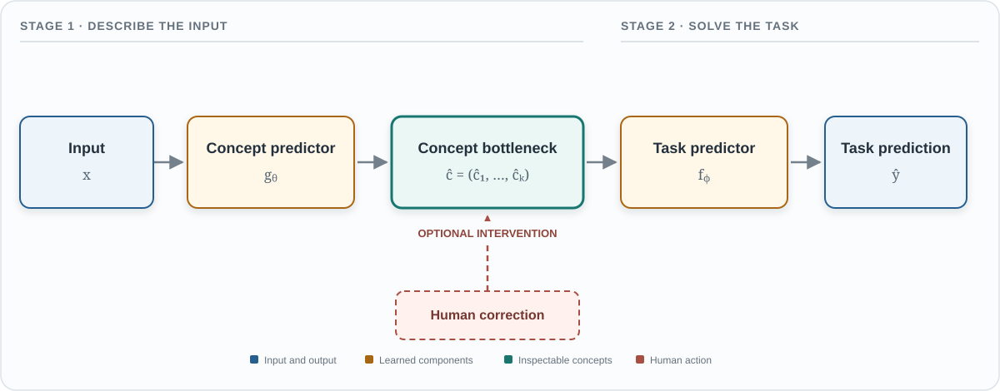
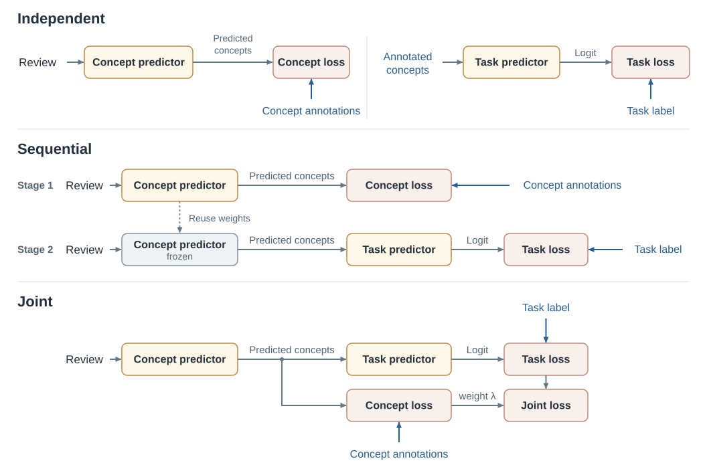

# Method A: Concept Bottleneck Models

A review can praise the pasta and complain about the service of the restaurant at the same time. If a model then decide to predicts *do not recommend* classification, which part of the review was responsible for this? A [Concept Bottleneck Model (CBM)](https://proceedings.mlr.press/v119/koh20a.html) makes task predictions through a predefined set of human-interpretable concepts. For each input, the model first predicts the presence or strength of these concepts and then uses their values to make the final prediction. This allows us to understand the model's predictions in terms of the concepts it relies on.

CBMs are a supervised concept-based approach. The concept vocabulary is chosen before training, unlike [concept discovery](method-B.qmd), where features are learned first and interpreted afterwards. The standard CBM builds this explanation into the model's architecture. We follow the seven questions in the [taxonomy](taxonomy.qmd).

::: {.callout-note title="Running example: restaurant recommendation"}
Consider an illustrative CBM that predicts whether a customer recommends a restaurant from a written review. The model uses three concepts:

| Concept | Meaning |
|---|---|
| Food quality | A rating from 0 for poor to 1 for excellent |
| Service speed | A rating from 0 for slow to 1 for fast |
| Intention to return | A binary property, with 0 for no and 1 for yes |

For the review *“The pasta was excellent, but we waited an hour and will not return,”* we would expect high food quality, low service speed, and a low probability of an intention to return. The task is to combine these different signals into a recommendation prediction.

This example concerns text classification. A transformer can supply the concept predictor, but the explanation describes the resulting CBM classifier, not every computation or generated answer of the underlying language model.
:::

## What does a CBM explain?

A CBM explains a task prediction through a chosen vocabulary. For our review, we can inspect whether the model detected good food, slow service, and no intention to return, then examine how those values affected the recommendation.

Suppose the model produces the following illustrative values, in that order:

$$
\widehat{\mathbf{c}}=(0.94,0.08,0.05).
$$

The first two values are predicted ratings on our chosen scales. The last is a predicted probability for the binary concept *intends to return*. These values give us the model's description of the review. They do not yet tell us the recommendation: that also depends on the task predictor.

For one review, the explanation is local. Across reviews, we can look for recurring concept errors or examine the fixed coefficients of a linear task predictor. For example, a model might consistently detect good food but overlook complaints about waiting time.

## Where does the explanation come from?

The explanation comes from the concept layer between the input and the task predictor. Each concept has an assigned meaning, and training encourages its predicted value to match annotations for that meaning. Simply giving names to arbitrary hidden dimensions would not establish this correspondence.

In a strict CBM, the task predictor receives only the concept vector. This gives us a specific part of the model to inspect and edit. The concept predictor itself can still be a complex neural network: a service-speed value does not reveal which words led the network to predict slow service. Explaining that earlier step may require a separate attribution method.

Even when all information passes through the concept layer, its numerical values might carry more information than the named concepts suggest. We will return to this issue when evaluating faithfulness.

## How does a CBM make a prediction? {#architecture-and-inference}

There are two learned components: a concept predictor $g_\theta$ and a task predictor $f_\phi$. For classification, $f_\phi$ calculates task logits, which are real-valued class outputs before conversion to probabilities. The final class prediction is obtained from those probabilities:

$$
x
\xrightarrow{\;g_\theta\;}
\widehat{\mathbf{c}}
\xrightarrow{\;f_\phi\;}
\boldsymbol{\ell}^{\mathrm{task}}
\longrightarrow
\widehat{y}.
$$ {#eq-cbm-pipeline}

The composed model is

$$
\boldsymbol{\ell}^{\mathrm{task}}
=
h_{\theta,\phi}(x)
=
f_\phi\!\left(g_\theta(x)\right).
$$ {#eq-cbm-model}

Here, $x$ is the restaurant review. The concept predictor estimates food quality, service speed, and intention to return. The task predictor combines those values into a recommendation logit, which is converted into a probability and then a class decision.

The concept vector is called a *bottleneck* because every task logit must be calculated from those values alone. There is no separate path from $x$ to the task output in a strict CBM. Some variants add other features to the task predictor, relaxing this restriction.

::: {.content-visible when-format="html"}

```{=html}
<figure style="margin: 1.5rem 0 2rem; text-align: center;">
  <object
    data="../figures/xlm/cbm-architecture.svg"
    type="image/svg+xml"
    style="display: block; width: 100%; max-width: 1200px; margin: 0 auto;"
    aria-label="Interactive diagram of a Concept Bottleneck Model">
    
  </object>
  <figcaption style="margin-top: 0.6rem; color: #64717d; font-size: 0.85rem;">
    Inference and optional concept correction in a strict Concept Bottleneck Model.
  </figcaption>
</figure>
```

:::

::: {.content-visible unless-format="html"}

{#fig-cbm-architecture width=100%}

:::

### Concept predictor and concept values

The architecture of $g_\theta$ depends on the input. It may use a convolutional network for images or a transformer for text. In our example, a transformer processes the review and predicts the three concept values.

Let $k$ be the number of concepts. The predicted concept vector is

$$
\widehat{\mathbf{c}}
=
(\widehat{c}_1,\ldots,\widehat{c}_k),
$$

where $\widehat{c}_j$ denotes the predicted value of concept $j$. Each concept has a predefined meaning, but its numerical representation depends on the type of concept.

| Concept type | Example | Common representation |
|---|---|---|
| Binary | Intends to return | A value in $\{0,1\}$, a probability in $[0,1]$, or a logit |
| Categorical | Type of restaurant | One value for each category |
| Ordinal | Service rating | An ordered value such as 1, 2, 3, 4, or 5 |
| Continuous | Waiting time | A real-valued measurement |

A hard binary value states whether a concept is present or absent. A probability gives a graded prediction. In our illustrative vector,

$$
\widehat{c}_{\mathrm{return}}=0.05
$$

assigns a low probability to an intention to return. Before applying the sigmoid function, a binary concept predictor may produce a logit $\ell_j^{\mathrm{concept}}\in\mathbb{R}$. A logit is an unnormalized real-valued output; sigmoid converts it into a probability:

$$
\widehat{c}_j
=
\sigma\!\left(\ell_j^{\mathrm{concept}}\right)
=
\frac{1}{1+e^{-\ell_j^{\mathrm{concept}}}}.
$$ {#eq-cbm-binary-concept}

For a categorical concept with $M$ mutually exclusive categories, softmax converts its logits into probabilities that sum to 1:

$$
\widehat{c}_{jm}
=
\frac{\exp\!\left(\ell_{jm}^{\mathrm{concept}}\right)}
{\displaystyle\sum_{q=1}^{M}\exp\!\left(\ell_{jq}^{\mathrm{concept}}\right)},
\qquad m=1,\ldots,M.
$$ {#eq-cbm-categorical-concept}

Continuous concepts can be predicted directly. For example, waiting time could be measured in minutes, or converted to a normalized rating with a defined scale. Ordinal concepts also need to preserve their ordering; treating a rating of 5 as merely a different category from 4 discards that relationship.

Soft values retain distinctions lost by thresholding. At a threshold of 0.5, probabilities of 0.51 and 0.99 both become 1. Neither a value between 0 and 1 nor the use of sigmoid establishes reliable confidence, however. For a calibrated binary predictor, examples assigned a probability near 0.8 should have the concept present about 80% of the time. [On Calibration of Modern Neural Networks](https://proceedings.mlr.press/v70/guo17a.html) discusses this distinction.

### Task predictor

The task predictor combines concept values into a task output. Because its input is the concept vector, it is often smaller than the concept predictor, although the bottleneck does not require a simple task predictor. A linear model makes this step relatively easy to inspect. A nonlinear model can capture interactions between concepts.

We use $\ell^{\mathrm{concept}}$ for logits produced by the concept predictor and $\ell^{\mathrm{task}}$ for task logits. Keeping the two separate matters: the probability of an intention to return is a different quantity from the probability of a recommendation.

#### Linear task predictor

Suppose the task has $R$ classes. A linear task predictor calculates one logit per class:

$$
\boldsymbol{\ell}^{\mathrm{task}}
=
W\widehat{\mathbf{c}}+\mathbf{b},
$$ {#eq-cbm-general-linear-head}

where $W\in\mathbb{R}^{R\times k}$ contains the concept weights and $\mathbf{b}\in\mathbb{R}^{R}$ contains the biases. For class $r$,

$$
\ell_r^{\mathrm{task}}(\widehat{\mathbf{c}})
=
b_r+\sum_{j=1}^{k}w_{rj}\widehat{c}_j.
$$ {#eq-cbm-linear-class-logit}

The logits are converted into class probabilities using softmax:

$$
p(y=r\mid\widehat{\mathbf{c}})
=
\frac{\exp\!\left(\ell_r^{\mathrm{task}}\right)}
{\displaystyle\sum_{q=1}^{R}\exp\!\left(\ell_q^{\mathrm{task}}\right)}.
$$ {#eq-cbm-softmax}

The predicted class $\widehat{y}$ is the one with the largest probability. A term $w_{rj}\widehat{c}_j$ is concept $j$'s contribution to class $r$'s logit relative to a zero concept value. The class probability depends on all the logits, not just that one term.

Our restaurant task is binary. Let $y=1$ mean *recommend* and $y=0$ mean *do not recommend*. We can use a single recommendation logit:

$$
\ell_{\mathrm{rec}}^{\mathrm{task}}(\widehat{\mathbf{c}})
=
b
+w_{\mathrm{food}}\widehat{c}_{\mathrm{food}}
+w_{\mathrm{speed}}\widehat{c}_{\mathrm{speed}}
+w_{\mathrm{return}}\widehat{c}_{\mathrm{return}}.
$$ {#eq-cbm-restaurant-linear-head}

Sigmoid converts it into a recommendation probability:

$$
p(y=1\mid\widehat{\mathbf{c}})
=
\sigma\!\left(\ell_{\mathrm{rec}}^{\mathrm{task}}(\widehat{\mathbf{c}})\right),
\qquad
\sigma(u)=\frac{1}{1+e^{-u}}.
$$ {#eq-cbm-restaurant-probability}

With a decision threshold of 0.5, the model predicts *recommend* when this probability is at least 0.5. A positive $w_{\mathrm{speed}}$ means that increasing the service-speed value raises the recommendation probability while the other concept values stay fixed.

The weights describe changes in the model's calculation. Since our concepts all range from 0 to 1, equal changes in their values can be compared on that scale. Weight magnitude alone still does not tell us which concept matters most across reviews: that also depends on the concept values and how they vary.

These calculations do not establish cause and effect in the restaurant. A positive service-speed weight does not prove that making service faster would cause a particular customer to recommend it.

#### Nonlinear task predictor

A nonlinear task predictor allows the effect of one concept to depend on the others. One common choice is a multilayer perceptron:

$$
\boldsymbol{\ell}^{\mathrm{task}}
=
f_\phi(\widehat{\mathbf{c}})
=
W_2
\rho\!\left(
W_1\widehat{\mathbf{c}}+\mathbf{b}_1
\right)
+\mathbf{b}_2,
$$ {#eq-cbm-general-nonlinear-head}

where $\rho$ is an activation function such as ReLU. With $d_h$ hidden units, $W_1\in\mathbb{R}^{d_h\times k}$ and $W_2\in\mathbb{R}^{R\times d_h}$; the bias vectors have $d_h$ and $R$ entries. For a binary predictor with one logit, the output dimension is 1 instead of $R$.

For our review, a simpler illustration is a predictor with a food-quality and service-speed interaction:

$$
\ell_{\mathrm{rec}}^{\mathrm{task}}(\widehat{\mathbf{c}})
=
b
+w_{\mathrm{food}}\widehat{c}_{\mathrm{food}}
+w_{\mathrm{speed}}\widehat{c}_{\mathrm{speed}}
+w_{\mathrm{return}}\widehat{c}_{\mathrm{return}}
+w_{\mathrm{food,speed}}
 \widehat{c}_{\mathrm{food}}
 \widehat{c}_{\mathrm{speed}}.
$$ {#eq-cbm-restaurant-nonlinear-head}

The recommendation probability is still

$$
p(y=1\mid\widehat{\mathbf{c}})
=
\sigma\!\left(\ell_{\mathrm{rec}}^{\mathrm{task}}(\widehat{\mathbf{c}})\right).
$$

If $w_{\mathrm{food,speed}}>0$, good food adds more to the logit when service is fast. The food-quality value itself need not change; its role in the task prediction changes with service speed. We can no longer describe its effect across all reviews using one weight.

## When is a CBM learned or used?

The standard CBM learns to predict the chosen concepts during supervised model training, then exposes concept predictions during inference. Other variants add a concept bottleneck to an already trained model. These are different stages of use, even though both produce a concept-based classifier.

### Training regimes

Suppose the training data contain triples $(x_i,\mathbf{c}_i,y_i)$: an input, its annotated concept values, and its task label. In @fig-cbm-training-regimes, follow the input to the task predictor: does it come from the annotations or from the concept predictor?

::: {.text-center}
{#fig-cbm-training-regimes width=100% fig-alt="Independent training fits the task predictor on annotated concepts. Sequential training fits it on predictions from a frozen concept predictor. Joint training updates both predictors using the task loss and also supervises the concepts."}
:::

1. **Independent training:** train $g_\theta$ on the concept annotations and train $f_\phi$ separately using the annotated concepts as inputs. At inference, $f_\phi$ receives predicted concepts instead. This creates a mismatch between the values it learned from and the values it will receive. See [Concept Bottleneck Models](https://proceedings.mlr.press/v119/koh20a/koh20a.pdf).

2. **Sequential training:** first train $g_\theta$, then freeze it and train $f_\phi$ on its predictions $g_\theta(x_i)$. The task predictor learns from predicted values, including their errors. Replacing these values with corrected concepts can still change the distribution it sees. See [Concept Bottleneck Models](https://proceedings.mlr.press/v119/koh20a/koh20a.pdf).

3. **Joint training:** train both components with a concept loss and a task loss. The task loss updates both $f_\phi$ and $g_\theta$, while the concept loss encourages alignment with the annotations. See [Concept Bottleneck Models](https://proceedings.mlr.press/v119/koh20a/koh20a.pdf).

   For one training example, a typical objective is

   $$
   \mathcal{L}
   =\lambda\,\mathcal{L}_{\text{concept}}
     \left(g_\theta(x_i),\mathbf{c}_i\right)
   +\mathcal{L}_{\text{task}}
     \left(f_\phi(g_\theta(x_i)),y_i\right),
   $$ {#eq-cbm-joint-loss}

   where $\lambda$ controls the weight of concept prediction relative to task prediction. A small concept loss weight can allow task prediction to improve while concept meanings become less reliable.

   [Auxiliary Losses for Learning Generalizable Concept-based Models](https://arxiv.org/abs/2311.11108) extends joint training with cooperative-CBM (coop-CBM). An auxiliary task head learns from the representation shared with the concept predictor. The objective combines concept, auxiliary-task, final-task, and concept orthogonal losses. The orthogonal loss encourages similarity within concept groups and separation between groups. The auxiliary head shapes the representation during training; the final task predictor still receives only the predicted concepts. The paper studies image classification, including distribution shifts.

The concept loss must match the concept type. Binary concepts commonly use binary cross-entropy, categorical concepts use cross-entropy, and continuous concepts use a regression loss. With partial concept annotations, the concept loss can be calculated over the observed entries.

### Reducing the need for concept annotations

Collecting task labels is one job; annotating every concept in every review is another. [Label-free Concept Bottleneck Models](https://arxiv.org/abs/2304.06129) reduce that second requirement by using concept names and a pretrained image-text model to provide concept targets. *Label-free* refers to per-example concept annotations, not to the absence of task labels or a concept vocabulary. Its image-classification pipeline would need a suitable source of concept supervision for our text example.

[Post-hoc Concept Bottleneck Models](https://arxiv.org/abs/2205.15480) use a trained backbone, project its representations onto concept directions, and fit a task predictor on those concept values. This avoids training the whole model from scratch. The resulting classifier is the model being explained; its agreement with the original model must be checked rather than assumed.

### Concept interventions

At inference, a person can correct a predicted concept and run the task predictor again. We do not need to retrain the model for that edit. If $S$ is the set of corrected concepts, define

$$
\widetilde{c}_j=
\begin{cases}
c_j^{\text{edit}}, & j\in S,\\
\widehat{c}_j, & j\notin S.
\end{cases}
$$ {#eq-concept-intervention}

The corrected vector gives new task logits $\widetilde{\boldsymbol{\ell}}^{\mathrm{task}}=f_\phi(\widetilde{\mathbf{c}})$. The revised class $\widetilde{y}$ follows from the same probability conversion and decision rule used before.

Suppose the concept predictor mistakenly gives our review a service-speed value of 0.8, despite the hour-long wait. A reviewer replaces it with 0.08 while keeping the food and return values fixed. We can then ask whether the recommendation changes. For the linear binary head, the change in the recommendation logit is $w_{\mathrm{speed}}(0.08-0.8)=-0.72w_{\mathrm{speed}}$. With a positive service-speed weight, the correction lowers the recommendation probability, though it need not change the final class.

This is a correction to the model's reading of the same review. It does not describe what would happen if the restaurant actually served the customer faster. Corrections also need to respect the representation: a probability-based concept can be edited on its probability scale, whereas a logit-based bottleneck needs an appropriate logit value. Related categorical concepts should be edited consistently.

## Which checks should a CBM pass? {#evaluating-a-cbm}

A high recommendation accuracy is not enough to evaluate the explanation. We also need to check the concept predictions and the effects of correcting them.

### Task and concept performance

Check task performance and concept performance separately:

- **Task performance:** accuracy or another suitable metric for the recommendation label.
- **Concept performance:** error for each food-quality and service-speed rating, and classification or probability quality for intention to return.
- **Concept-set sufficiency:** how well a task predictor can perform using the annotated concepts. Poor performance can reflect missing concepts, noisy annotations, or an unsuitable predictor.
- **Intervention performance:** task performance after selected concept corrections, including the number and choice of concepts corrected.

An average concept result can hide a weak concept. Good recommendation accuracy can also coexist with poor service-speed prediction, so we should inspect each concept on held-out reviews.

### Faithfulness and completeness

For a strict CBM, the task predictor uses only the concept vector. With a linear head, the bias and all weighted concept terms account for the task logit; showing only the largest terms leaves part of that calculation out. This concerns completeness with respect to the model's calculation, not coverage of every reason a customer might have for recommending a restaurant.

Soft values need particular care. Small differences in concept probabilities can encode task information beyond the stated concept meaning. [Addressing Leakage in Concept Bottleneck Models](https://papers.neurips.cc/paper_files/paper/2022/hash/944ecf65a46feb578a43abfd5cddd960-Abstract-Conference.html) examines this *concept leakage*. Concept accuracy alone cannot rule it out. An interpretable name, a high task accuracy, and a strict architecture are therefore insufficient to establish a faithful explanation in the intended human vocabulary.

A residual path introduces a different limitation: it gives the task predictor information outside the named concepts. That may improve prediction, but the concept values then explain only part of the computation.

### Causal validity and stability

A concept intervention tests a relationship inside the model. For a linear head, its logit change should match the weight and the size of the edit. Neither that agreement nor an improved recommendation establishes a causal effect of restaurant service on customer behaviour.

Stability concerns how the explanation changes across comparable inputs. We could paraphrase the review while preserving its meaning, then check both concept values and the task prediction. Large unexplained changes would call the concept predictor's reliability into question. Perfectly stable values are not a requirement when the review's meaning actually changes.

### Human interpretability

Test whether the intended reader can use the explanation. For our example, a reader might identify an incorrectly predicted service rating or predict how a specified correction would affect the recommendation. Those tasks assess understanding more directly than asking whether a concept display looks convincing.

The display must also make its numbers clear. A food-quality rating, a return probability, and a concept logit need different explanations, even if all three appear next to readable labels.

## Why choose a CBM? {#limitations-and-appropriate-use-cases}

A CBM is useful when disagreement with a prediction can be expressed through concepts. If our review receives an unexpected recommendation, we can ask two concrete questions: did the model misread the service, or did the task predictor give service little weight? The first points to the concept predictor; the second to the task predictor.

The approach requires a vocabulary relevant to the task, sufficiently reliable concept supervision, and a way to inspect the predicted values. Missing concepts can restrict a strict model's task performance. Annotation cost, ambiguous labels, and shortcuts in the concept predictor also remain practical problems. A nonlinear task head can further make the concept-to-prediction step difficult to follow.

Choose the vocabulary with the intended use in mind. Concepts that readers cannot assess or correct are difficult to use for feedback. In our example, an unclear review should allow uncertainty about the customer's intention to return, rather than forcing an annotator to invent a confident answer.

## Who uses the explanation?

Model developers can compare concept errors with task errors to decide whether to improve the text encoder, the concept supervision, or the task predictor. Reviewers with suitable task knowledge can correct concept predictions through an interface without editing model parameters.

Auditors need evidence that the concept values measure their stated properties, that the task predictor uses the reported values, and that any additional prediction paths are disclosed. End users may need only the relevant concept values and an understandable account of their role in the decision, rather than access to the full network.

For our restaurant example, a useful interface would let a reader check the food, service, and return predictions, correct a mistaken value, and see the resulting recommendation.
