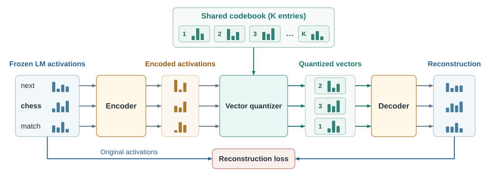
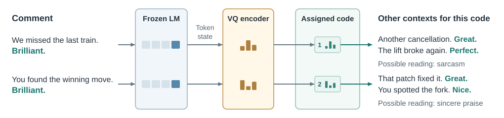

# Method B: VQ-VAE-based interpretability

An attribution method like layer GradCam can estimate which token's representation contributed the most to the model's prediction or generated output. However, due to the contexualized nature of the token representation, it becomes harder to understand which information in that representation was actually relevant to the prediction. Furthermore, according to superposition hypothesis as visited in SAE, many concepts can simultaneously activate same neuron. This makes reasoning based off the attributed neuron/representation in the network difficult. 

Lets look at a new running example which shows how model can behaves when the sentence said not very directly.

::: {.callout-note title="Running example: toxicity classification"}
Consider a language model that classifies comments as toxic or non-toxic. How might it read these two comments?

- "I'll destroy you in our next chess match. Same time tomorrow?"
- "Brilliant point. The discussion was better before you joined."

In the above example, the first comment is a friendly competitive banter. Suppose the classifier labels it as toxic. We want to check whether if model groups "destroy" activation with activations which are similar to literal threat. Similarily, the second comment is an example of hostile sarcasm where "brilliant" should ideally be grouped with a sarcastic attack instead of sincere praise.
:::

The hidden activation for "destroy" may carry information about both violent wording and a competitive setting. So while we have a position to inspect because of attribution methods, we still need figure out which specific meaning the activation align with. In the second example, mdoel can interpret the word "brilliant" as a strong positive statement which undermines the actual sarcastic and hostile nature of the comment

One way to tackle above problem is to group examples with similar intentions together and then try to explain the inference example based on the semantic associations with the group it is closest to. While clustering based approached may be the first thing that comes into the mind, they have few problems. Firstly, clustering based approaches do not scale well with dataset size. As shown in this work [https://arxiv.org/abs/2602.02726], clustering based approaches like K-means and hierarchial clustering have higher runtime or memory complexity as dataset size increases. Secondly, their training objective cannot capture concepts that maybe be split across layers as their objective is limited to clustering single layer activations.  This is where VQVAE comes in. 

VQ-VAEs have been extensively explored in computer vision to discretize the continuous representations of images into codebook vectors. But what exactly is a VQ-VAE? Think of it like taking a continuous audio recording and converting it into a sequence of simple MIDI notes. The audio is first broken down into tiny, individual time slices. We take each slice (the continuous representation), encode it, and map it to the closest match from a fixed, finite set of piano keys (the codebook). Then, we decode that sequence of discrete notes to reconstruct the original audio. By squeezing the data through this bottleneck beat-by-beat, it naturally produces the effect of removing background static and minor variations from the representation, forcing the codebook vectors to only encode the core, defining features of that sound.

A codebook vector can be imagined as one of those fundamental notes. When the VQ-VAE training objective of reconstruction is applied to language model activations, these codebook vectors tend to capture interpretable linguistic concepts, spanning both syntactic patterns and semantic categories. While the reconstruction objective might look similar to Sparse Autoencoders (SAEs), their approaches are fundamentally different. VQ-VAEs snap each complex activation to a single, high-level concept. SAEs, in contrast, reconstruct it by blending a sparse mix of highly specific notes.

## What do the codes explain?

In our [taxonomy](taxonomy.qmd), VQ-VAE-based methods help us examine the information in a language model's internal representations. Each code groups encoded activations that the reconstruction model treats as similar, and we inspect their associated words and contexts to look for a shared meaning. Some groups may describe threatening language, sarcasm, or grammatical patterns, while others may contain several meanings that do not fit one clear concept name. [VQLC](https://arxiv.org/abs/2602.02726v2) uses these assignments to construct and inspect latent concepts.

For our chess example, suppose the activation for "destroy" is assigned to a code whose other examples mostly contain literal threats. This places its encoded representation alongside threatening contexts, despite the competitive setting. It gives us a possible explanation for the classifier's mistake. We can test this by changing the relevant activations and checking whether the prediction changes. The assignment alone does not show which information the classifier used.

The same codebook can be used across comments. Looking at its groups across the dataset gives us a global view of the patterns it has learned. For a local explanation, we inspect the codes assigned to relevant tokens in one comment and retrieve examples from those groups.

Unlike the standard supervised [Concept Bottleneck Model (CBM) in Method A](method-A.qmd), these methods learn their groups without predefined concept annotations. The original language model continues to make predictions through its own network, without passing through the discovered codes. The groups help us interpret its activations, but explaining a particular prediction also requires checking how the information they represent affects the output.

## Where does the evidence come from?

We start with hidden activations at selected layers and token positions. These are contextual representations, so the same word can receive different codes in different sentences. The code assigned to "brilliant" in our example need not be the code it receives in a sincere compliment.

The choice of layer and position determines what we are grouping. A token activation describes that token in context, while a pooled sentence activation summarizes several positions. The equations below use token activations. Comparing layers lets us investigate where a pattern appears, but a code learned at one layer should not automatically be treated as the same concept at another.

For each assignment, retain the source text and mark the token whose activation was encoded. If a word is split into subword tokens, either keep those positions separate or specify how their activations are combined. CLVQ-VAE aggregates subwords into word-level activations for analysis. Our running example uses whole words for readability.

This analysis requires access to internal activations and a corpus covering varied contexts. Generated text or predicted labels alone are insufficient to train an activation-reconstruction model.

## How do VQ-VAE-based methods work? {#general-architecture}

The original [VQ-VAE](https://proceedings.neurips.cc/paper/2017/hash/7a98af17e63a0ac09ce2e96d03992fbc-Abstract.html) learned discrete representations for images, video, and speech. For an image, an encoder produces a grid of feature vectors, a quantizer replaces each vector with a codebook entry, and a decoder reconstructs the image. A generative model can learn a distribution over codes in this compressed space. [VQ-VAE-2](https://proceedings.neurips.cc/paper/2019/hash/5f8e2fa1718d1bbcadf1cd9c7a54fb8c-Abstract.html) added a hierarchy of codebooks at different spatial scales.

For language-model interpretation, both the input and the reconstruction target are activation vectors. The encoder learns a transformation of those activations, the quantizer replaces each transformed vector with a shared entry, and the decoder tries to recover the target from the selected entries. Here, the encoder and decoder belong to the additional reconstruction model, not the original language model.

Suppose the encoded activation for “chess” is closest to the vector for code 3, as in @fig-vqvae-single-layer. The decoder receives that vector.

::: {.text-center}
{#fig-vqvae-single-layer width=100% fig-alt="The quantizer assigns codes 2, 3 and 1 to next, chess and match. The decoder uses the corresponding codebook vectors to reconstruct the activations from the same language-model layer."}
:::

Let $\mathbf{h}_t^{(l)}\in\mathbb{R}^{d}$ be the $d$-dimensional activation at position $t$ in layer $l$. With encoder $E_\theta$, quantizer $Q$, and decoder $D_\psi$, the per-position reconstruction path is

$$
\mathbf{h}_t^{(l)}
\xrightarrow{\;E_\theta\;}
\mathbf{z}_{e,t}
\xrightarrow{\;Q\;}
\mathbf{z}_{q,t}
\xrightarrow{\;D_\psi\;}
\widehat{\mathbf{r}}_t.
$$ {#eq-vqvae-concept-pipeline}

Here, $\theta$ and $\psi$ are the encoder and decoder parameters. The continuous encoder output $\mathbf{z}_{e,t}$ is replaced by the selected codebook vector $\mathbf{z}_{q,t}$, from which the decoder produces an approximation $\widehat{\mathbf{r}}_t$ to the target activation $\mathbf{r}_t$. Its training target is internal information, rather than a toxicity label or the original sentence. This per-position path supplies only the selected vector to the decoder. A decoder can also be designed to receive sequence context.

For a single-layer objective, the target is the input activation, $\mathbf{r}_t=\mathbf{h}_t^{(l)}$, as in [Vector Quantized Latent Concepts (VQLC)](https://arxiv.org/abs/2602.02726v2). The decoder reconstructs this activation from its coarse codebook representation, so training encourages the codes to retain patterns needed to recover information at the same layer.

A cross-layer objective uses an upper-layer activation as the target, $\mathbf{r}_t=\mathbf{h}_t^{(u)}$, where $u>l$, as in [Cross-Layer Vector Quantized-Variational Autoencoder (CLVQ-VAE)](https://arxiv.org/abs/2506.20040v4). The goal is to predict the higher-layer activation using the coarse representation of the lower-layer input, as shown in @fig-clvqvae-cross-layer. This encourages the codebook to capture patterns useful for the transformation from the lower to the higher layer.

::: {.text-center}
.](../figures/xlm/method-diagrams/clvq-vae-architecture.svg){#fig-clvqvae-cross-layer width=100% fig-alt="The quantizer assigns codes 2, 3 and 1 to next, chess and match. The decoder uses their codebook vectors and the continuous encoder outputs to reconstruct the higher-layer activations for those tokens."}
:::

### Learning a discrete codebook {#discrete-codebook}

The quantizer uses a shared codebook

$$
\mathcal{E}=\{\mathbf{e}_1,\ldots,\mathbf{e}_K\},
\qquad
\mathbf{e}_j\in\mathbb{R}^{d_c},
$$

where $K$ is the number of codes and $d_c$ is their dimension. The encoder output also has dimension $d_c$. Nearest-code lookup compares that output with every entry and returns the index of the closest one:

$$
j_t^*
=
\arg\min_{1\leq j\leq K}
\left\|\mathbf{z}_{e,t}-\mathbf{e}_j\right\|_2^2,
\qquad
\mathbf{z}_{q,t}=\mathbf{e}_{j_t^*}.
$$ {#eq-vqvae-nearest-code}

Suppose $\mathbf{z}_{e,t}=(0.8,0.2)$ and the codebook contains $(1,0)$ and $(0,1)$. Their squared distances from the encoder output are $0.2^2+0.2^2=0.08$ and $0.8^2+0.8^2=1.28$, respectively. The quantizer replaces the output with the first entry. The index is discrete, although the selected vector still contains real-valued coordinates. The index identifies a group. It does not measure the strength or probability of a concept.

Replacing different encoder outputs with the same entry discards their differences at the quantizer. In the per-position path above, the decoder receives the same vector for all of them, so it must produce the same reconstruction. Training balances the reuse of entries with the information needed to reconstruct their targets. The groups are learned for reconstruction and may not match human concept names.

A larger codebook gives the encoder more entries to choose from, but each lookup has more distances to compare. Mini-batching limits the comparisons to one batch and the codebook. Collecting language-model activations and training the extra networks add computation too.

### Reconstruction and training {#training-objective}

The decoder learns to recover the target activation from the selected codes. We measure its error with

$$
\mathcal{L}_{\mathrm{rec}}
=
\left\|\mathbf{r}_t-\widehat{\mathbf{r}}_t\right\|_2^2.
$$ {#eq-vqvae-reconstruction}

A small change to the encoder output can leave the selected code unchanged. The decoder then receives the same vector, so ordinary backpropagation through the lookup cannot guide the encoder. A straight-through estimator works around this by using the selected code in the forward pass and passing the decoder's gradient back to the encoder as if quantization had not changed its output.

We use a commitment loss to pull encoder outputs toward their selected codes. For this loss, we want the encoder to move and the selected code to stay fixed. The stop-gradient trick, written $\operatorname{sg}$, does this by treating the code as a constant during backpropagation. Its value still counts when we calculate the loss

$$
\mathcal{L}_{\mathrm{commit}}
=
\left\|\mathbf{z}_{e,t}
-\operatorname{sg}(\mathbf{z}_{q,t})\right\|_2^2.
$$ {#eq-vqvae-commitment}

#### Gradient-based codebook updates

Codebook vectors are learned parameters too. With the usual straight-through estimator, the reconstruction gradient is passed to the encoder, so the entries need their own update. The [original VQ-VAE](https://proceedings.neurips.cc/paper/2017/hash/7a98af17e63a0ac09ce2e96d03992fbc-Abstract.html) uses a codebook loss that holds the encoder output fixed and trains the selected entry to move toward it

$$
\mathcal{L}_{\mathrm{codebook}}
=
\left\|\operatorname{sg}(\mathbf{z}_{e,t})
-\mathbf{e}_{j_t^*}\right\|_2^2.
$$ {#eq-vqvae-codebook-loss}

Both distance losses are $0.08$ for the vectors in our earlier example, but their stop-gradient placement decides which side learns. The commitment loss pulls the encoder output toward $(1,0)$, while the codebook loss pulls the entry toward $(0.8,0.2)$. In a batch, an entry receives codebook gradients from the examples assigned to it.

The full gradient-based objective combines the three losses

$$
\mathcal{L}
=
\mathcal{L}_{\mathrm{rec}}
+
\mathcal{L}_{\mathrm{codebook}}
+
\beta\mathcal{L}_{\mathrm{commit}},
\qquad \beta\geq 0.
$$ {#eq-vqvae-total-loss}

The losses are averaged over training positions, and $\beta$ controls the commitment penalty.

#### Moving-average codebook updates

Another option is to update each entry using an exponential moving average (EMA) of the encoder outputs assigned to it. The entry follows a smoothed mean that retains information from earlier batches while giving recent batches more weight.

EMA replaces the gradient-based codebook update, so we leave $\mathcal{L}_{\mathrm{codebook}}$ out of the objective. The encoder and decoder still learn through backpropagation using the reconstruction and commitment losses. [VQLC](https://arxiv.org/abs/2602.02726v2) and [CLVQ-VAE](https://arxiv.org/abs/2506.20040v4) use this choice.

### Giving codes a concept meaning {#interpreting-code-groups}

To understand a codebook vector, we look for patterns in the examples assigned to it, as in [VQLC](https://arxiv.org/abs/2602.02726v2). We can describe the same group using common words, longer contexts, or a short concept name. These descriptions can be used together.

Compare the two uses of “Brilliant” in @fig-vqvae-code-groups. Which other words share a code with each one?

::: {.text-center}
{#fig-vqvae-code-groups width=100% fig-alt="After a missed train, Brilliant is assigned code 1, which it shares with sarcastic remarks. After a winning move, the same word is assigned code 2, which it shares with compliments."}
:::

1. The most common words give a quick summary of the group. If "destroy" and similar words occur often, we might describe the vector as related to aggressive language. The words alone may not tell us whether the language is threatening or playful.

2. Phrases and full sentences help us distinguish different uses of the same word. For example, "in our next chess match" changes how we read "destroy". If this kind of context appears across the group, "competitive banter" may be a better description than "literal threats".

3. A \acr{llm} can suggest a concept name and description from the grouped words, phrases, or sentences. [Automatically Interpreting Millions of Features in Large Language Models](https://proceedings.mlr.press/v267/paulo25a.html) uses this idea for SAE features, and we can apply it to code groups too. The suggested meaning still needs checking.

A description should fit a mix of common and less common examples, including examples that were not used to choose it. If a code mixes threats and friendly competition, a single label may hide that difference. Some groups need several descriptions or have no clear shared meaning.

For a model-generated name, several other \acr{llm} judges can check whether it fits new examples. We record where they agree or disagree, and human reviewers can also check a sample. Disagreements help us see where the name may need changing. Agreement alone does not guarantee that the name is correct.

### Using codes to explain a prediction {#explaining-with-code-groups}

We can use these groups to inspect a prediction. For the chess comment, we look at other examples assigned to the same code as "destroy". Do they contain threats, friendly competition, or both?

1. For the chess comment, we assume the model predicts toxic. We can look at several token positions or use attribution to choose one. [CLVQ-VAE](https://arxiv.org/abs/2506.20040v4) uses Layer Integrated Gradients for this. For our example, the attribution estimates each token's contribution to the toxic-class output.

2. Suppose we choose "destroy". We take its activation from the chosen layer, pass it through the trained encoder, and find the nearest code using @eq-vqvae-nearest-code. We can then look up the examples and suggested meaning for that code. This lookup uses the encoder and codebook, not the decoder.

3. Suppose most examples in that group are threats. The reconstruction model has grouped this use of "destroy" with threatening language, even though the comment is about chess. If the group also contains playful competition, "literal threats" may not describe it well. These examples suggest a possible reason for the mistake, but we still need to test whether the classifier used that information.

The same steps apply to "brilliant" in the second comment and to positions in the dismissive sentence. A causal language model can only use earlier and current tokens at each position, so its activation for "brilliant" cannot use the sentence that follows. A bidirectional model such as [BERT](https://aclanthology.org/N19-1423/) can use that later context. A praise-like code at the earlier position does not by itself show that the classifier missed the sarcasm when processing the full comment.
