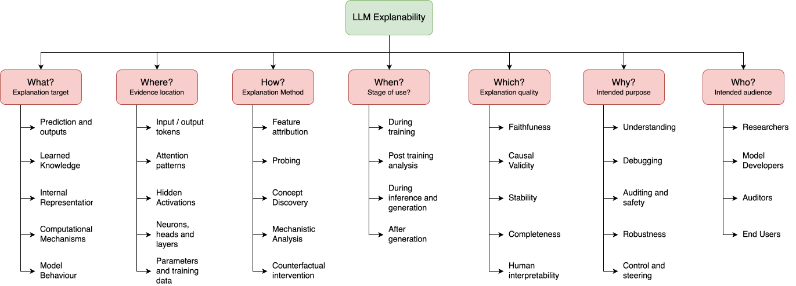

# Taxonomy

We organize LLM explainability around seven questions: **What, Where, How, When, Which, Why, and Who**, as shown in @fig-llm-explainability-taxonomy. These questions help us describe what each method explains, how it works, and how it is used and evaluated.

The chapters that follow will each focus on an explanation method from **How**. We will use the other six questions to discuss what the method explains, where its evidence comes from, when and why to use it, how to evaluate it, and who it is useful for.

::: {style="text-align: center;"}
{#fig-llm-explainability-taxonomy width=100%}
:::

## What? Explanation Target

- **Predictions and outputs:**

  - One answer, predicted class, or generated token; the particular decision being explained
  - Words or phrases behind that decision, such as positive or negative wording in a restaurant review
  - Reasons tied to that input and output; possibly different reasons for another example
  - Reading: [Axiomatic Attribution for Deep Networks](https://proceedings.mlr.press/v70/sundararajan17a.html)

- **Learned knowledge:**

  - Facts and associations picked up during training, such as a person's occupation or a country's capital
  - Different prompts for the same fact; checks across types of facts and versions of the model
  - Correct answers under one wording versus consistent answers across prompts; possible effects of memorization
  - Reading: [Language Models as Knowledge Bases?](https://aclanthology.org/D19-1250/)

- **Internal representations:**

  - Information in hidden states about grammar, word meaning, and the context of a sentence
  - Comparisons across layers and token positions; properties becoming easier or harder to recover
  - Information present in a representation versus information used for prediction; separate tests for actual use
  - Reading: [BERT Rediscovers the Classical NLP Pipeline](https://aclanthology.org/P19-1452/)

- **Computational mechanisms:**

  - Steps inside the model that connect an input to an output; the parts involved at each step
  - Induction heads as an example: attention heads using an earlier token pattern to help continue a repeated one
  - Tests of the proposed steps by changing or disabling the relevant components
  - Reading: [In-context Learning and Induction Heads](https://arxiv.org/abs/2209.11895)

- **Model behaviour:**

  - Tasks the model handles well and cases where it fails; patterns hidden by overall test accuracy
  - Input edits that should preserve the prediction and edits that should change it
  - Examples involving negation, names, or distracting text; observed behaviour as a starting point for investigating its causes
  - Reading: [Beyond Accuracy: Behavioral Testing of NLP Models with CheckList](https://aclanthology.org/2020.acl-main.442/)

## Where? Evidence Location

- **Input and output tokens:**

  - Evidence in prompt words, earlier generated tokens, or longer spans of text
  - Contributions to a particular output; different effects of the same word in different contexts
  - Highlights over individual tokens or whole phrases; subword tokens grouped into readable words where appropriate
  - Reading: [Axiomatic Attribution for Deep Networks](https://proceedings.mlr.press/v70/sundararajan17a.html)

- **Attention patterns:**

  - Token positions receiving attention, including earlier mentions, nearby words, and special tokens
  - Patterns across heads and layers; possible roles in passing information between positions
  - Attention weights as clues; separate tests of how changing them affects the prediction
  - Reading: [Attention is not Explanation](https://aclanthology.org/N19-1357/)

- **Hidden activations:**

  - Vectors produced at chosen layers and token positions; a view of information beyond the final answer
  - Recurring patterns in these vectors; dictionaries and codebooks for examining features spread across dimensions
  - CLVQ-VAE example: lower-layer activations assigned to discrete codes, then used to reconstruct higher-layer activations
  - Reading: [Sparse Autoencoders Find Highly Interpretable Features in Language Models](https://proceedings.iclr.cc/paper_files/paper/2024/hash/1fa1ab11f4bd5f94b2ec20e794dbfa3b-Abstract-Conference.html); [Cross-Layer Discrete Concept Discovery for Interpreting Language Models](https://arxiv.org/abs/2506.20040v3)

- **Neurons, heads, and layers:**

  - Roles of particular neurons, attention heads, or layers; checks on what changes when their outputs are removed or replaced
  - Several components working together in a circuit; a computation spread across heads or layers
  - Roles tied to the tested task and inputs; possible changes in another context
  - Reading: [In-context Learning and Induction Heads](https://arxiv.org/abs/2209.11895)

- **Parameters and training data:**

  - Weight edits to test a factual association; checks for unwanted changes to unrelated predictions
  - Training examples linked to a prediction; estimates of the effect of removing them or changing their training weight
  - Limits of these estimates, especially when tracing a generated answer to individual training examples
  - Reading: [Locating and Editing Factual Associations in GPT](https://papers.neurips.cc/paper_files/paper/2022/hash/6f1d43d5a82a37e89b0665b33bf3a182-Abstract-Conference.html); [Understanding Black-box Predictions via Influence Functions](https://proceedings.mlr.press/v70/koh17a.html)

## How? Explanation Method

- **Feature attribution:**

  - Importance values for words or other input features, tied to the output being explained
  - Positive and negative contributions; effects of the attribution method and chosen reference input
  - Hybrid example: the structure of Neural Classification Trees (NCT), supplemented by LayerGradCAM maps showing relevant image regions
  - Reading: [Axiomatic Attribution for Deep Networks](https://proceedings.mlr.press/v70/sundararajan17a.html); [Discovering Latent Groups for Robust Classification](https://arxiv.org/abs/2606.23609v2)

- **Probing:**

  - A separate predictor trained on the model's hidden states to recover a known property, such as a grammatical relation
  - Comparisons across layers and with simple baselines; checks on how much the probe itself can learn
  - Information available to the probe versus information used by the original model for its task
  - Reading: [A Structural Probe for Finding Syntax in Word Representations](https://aclanthology.org/N19-1419/); [Causal Abstractions of Neural Networks](https://proceedings.neurips.cc/paper_files/paper/2021/hash/4f5c422f4d49a5a807eda27434231040-Abstract.html)

- **Concept discovery:**

  - Recurring patterns learned from activations without starting with named concepts or concept annotations
  - Sparse combinations of continuous features in SAEs; discrete code assignments in CLVQ-VAE
  - Meaning inferred from the tokens and contexts associated with a feature; checks on shared meaning and effects on model behaviour
  - Reading: [Sparse Autoencoders Find Highly Interpretable Features in Language Models](https://proceedings.iclr.cc/paper_files/paper/2024/hash/1fa1ab11f4bd5f94b2ec20e794dbfa3b-Abstract-Conference.html); [Cross-Layer Discrete Concept Discovery for Interpreting Language Models](https://arxiv.org/abs/2506.20040v3)

- **Mechanistic analysis:**

  - A proposed circuit for a particular task; the components involved and the information passed between them
  - Tests of the circuit by removing or replacing component outputs and checking the resulting prediction
  - Tasks and inputs covered by the explanation; parts of the computation still unexplained
  - Reading: [In-context Learning and Induction Heads](https://arxiv.org/abs/2209.11895)

- **Counterfactual intervention:**

  - A deliberate change to an input or internal state; comparison with a model run kept otherwise the same
  - Example: replacing an activation with the activation at the same position and layer from another input
  - Expected changes in the answer if the explanation is right; checks on the choice of intervention and comparison
  - Reading: [Causal Abstractions of Neural Networks](https://proceedings.neurips.cc/paper_files/paper/2021/hash/4f5c422f4d49a5a807eda27434231040-Abstract.html)

## When? Stage of Use

- **During training:**

  - Concepts, selected evidence, or visible groups built into the model design or training objective
  - Rationale models: learning to select evidence and predict from it together, with penalties for long or scattered selections
  - NCT example: easy/hard groups built into the architecture, with post-hoc attribution used to inspect its neural components
  - Reading: [Rationalizing Neural Predictions](https://aclanthology.org/D16-1011/); [Discovering Latent Groups for Robust Classification](https://arxiv.org/abs/2606.23609v2)

- **Post-training analysis:**

  - Analysis of an already trained model, with its original weights held fixed
  - Separate probes or feature dictionaries learned from its activations; comparisons across layers and examples
  - CLVQ-VAE example: training an additional model on extracted activations to discover discrete concepts
  - Reading: [A Structural Probe for Finding Syntax in Word Representations](https://aclanthology.org/N19-1419/); [Cross-Layer Discrete Concept Discovery for Interpreting Language Models](https://arxiv.org/abs/2506.20040v3)

- **During inference and generation:**

  - Access to hidden states as tokens are generated; monitoring or edits before the response is complete
  - TRACE example: risk estimates from current and earlier activations and their assigned concepts
  - Activation edits affecting the next tokens; extra computation and possible effects on otherwise safe responses
  - Reading: [Inference-Time Intervention: Eliciting Truthful Answers from a Language Model](https://proceedings.neurips.cc/paper_files/paper/2023/hash/81b8390039b7302c909cb769f8b6cd93-Abstract-Conference.html); [TRACE: Temporal Risk Assessment and Concept Editing for Safer Language Generation](https://arxiv.org/html/2610.15365v1)

- **After generation:**

  - Review of a completed answer using supporting text, token attributions, or saved internal states
  - Checks on the proposed explanation by removing evidence or making other controlled changes
  - A convincing written justification versus an explanation of the model's actual computation
  - Reading: [ERASER: A Benchmark to Evaluate Rationalized NLP Models](https://aclanthology.org/2020.acl-main.408/); [Language Models Don't Always Say What They Think: Unfaithful Explanations in Chain-of-Thought Prompting](https://arxiv.org/abs/2305.04388)

## Which? Explanation Quality

- **Faithfulness:**

  - Reasons in the explanation matching what the model actually used for its prediction
  - Tests that remove or change the claimed evidence, with suitable comparisons such as random changes
  - CLVQ-VAE example: removal of a concept direction tested through a linear probe; evidence about the representation, not a direct test of the original prediction head
  - Reading: [Towards Faithfully Interpretable NLP Systems: How Should We Define and Evaluate Faithfulness?](https://aclanthology.org/2020.acl-main.386/); [Cross-Layer Discrete Concept Discovery for Interpreting Language Models](https://arxiv.org/abs/2506.20040v3)

- **Causal validity:**

  - Changes to a model component followed by the output change expected from the explanation
  - A feature associated with an answer versus a feature whose alteration changes that answer
  - Conclusions tied to the tested intervention; causes inside the model separate from causes in the real world
  - Reading: [Investigating Gender Bias in Language Models Using Causal Mediation Analysis](https://papers.neurips.cc/paper_files/paper/2020/hash/92650b2e92217715fe312e6fa7b90d82-Abstract.html)

- **Stability:**

  - Similar explanations for inputs with similar meaning and comparable model predictions
  - Checks under small wording changes, irrelevant context, or repeated runs of the explanation method
  - Unexplained variation versus reasonable changes when the model's prediction itself changes
  - Reading: [Towards Robust Interpretability with Self-Explaining Neural Networks](https://papers.nips.cc/paper/2018/hash/3e9f0fc9b2f89e043bc6233994dfcf76-Abstract.html)

- **Completeness:**

  - How much of the selected prediction the explanation accounts for; contributions left out of a short feature list
  - Integrated Gradients example: contributions adding up to the difference in a selected output value from a reference input
  - Accounting for an output difference; no guarantee of covering every step inside the model
  - Reading: [Axiomatic Attribution for Deep Networks](https://proceedings.mlr.press/v70/sundararajan17a.html)

- **Human interpretability:**

  - Familiar concepts and enough detail for the reader's task and background
  - Tests of whether readers can predict model outputs or spot errors using the explanation
  - Demonstrated understanding alongside ratings of readability, satisfaction, or persuasiveness
  - Reading: [Towards A Rigorous Science of Interpretable Machine Learning](https://arxiv.org/abs/1702.08608)

## Why? Intended Purpose

- **Understanding:**

  - Reasons behind particular predictions and patterns shared across several examples
  - Questions about what the model represents, which evidence matters, or how an answer is produced
  - A clear distinction between findings about one answer and claims about the model more generally
  - Reading: ["Why Should I Trust You?": Explaining the Predictions of Any Classifier](https://arxiv.org/abs/1602.04938)

- **Debugging:**

  - Reliance on misleading clues, overlooked evidence, or unexpected changes after simple input edits
  - Shared problems across failed examples; possible issues in the data, training, or model
  - Changes aimed at those problems, followed by checks on both failed examples and previously correct ones
  - Reading: [Semantically Equivalent Adversarial Rules for Debugging NLP models](https://aclanthology.org/P18-1079/)

- **Auditing and safety:**

  - Investigation of bias, harmful answers, and false alarms; reasons behind a safeguard's decisions
  - TRACE example: records of concepts encountered during detection and concepts targeted by activation edits
  - Concept names added after training for inspection; associations with harmful responses insufficient to establish causation or safety
  - Reading: [Investigating Gender Bias in Language Models Using Causal Mediation Analysis](https://papers.neurips.cc/paper_files/paper/2020/hash/92650b2e92217715fe312e6fa7b90d82-Abstract.html); [TRACE: Temporal Risk Assessment and Concept Editing for Safer Language Generation](https://arxiv.org/html/2610.15365v1)

- **Robustness:**

  - Prediction changes after edits that preserve meaning, or when training-set shortcuts no longer hold
  - Weak cases and subgroups hidden by average performance; tests of reliance on misleading clues
  - NCT example: separate neural heads for learned easy/hard groups; group information retained alongside the class prediction
  - Reading: [Semantically Equivalent Adversarial Rules for Debugging NLP models](https://aclanthology.org/P18-1079/); [Discovering Latent Groups for Robust Classification](https://arxiv.org/abs/2606.23609v2)

- **Control and steering:**

  - Changes to activation directions or discovered concepts to influence the generated response
  - TRACE example: selected activation edits toward nearby benign concept targets, based on the current token's assignment
  - Checks on edit strength, the intended behaviour change, and unwanted effects on useful responses
  - Reading: [Inference-Time Intervention: Eliciting Truthful Answers from a Language Model](https://proceedings.neurips.cc/paper_files/paper/2023/hash/81b8390039b7302c909cb769f8b6cd93-Abstract-Conference.html); [TRACE: Temporal Risk Assessment and Concept Editing for Safer Language Generation](https://arxiv.org/html/2610.15365v1)

## Who? Intended Audience

- **Researchers:**

  - Questions about what the model has learned and how its components produce a behaviour
  - Controlled experiments and comparisons with simple baselines or alternative explanations
  - Enough detail to repeat the analysis, including the tested models, inputs, and remaining uncertainties
  - Reading: [Causal Abstractions of Neural Networks](https://proceedings.neurips.cc/paper_files/paper/2021/hash/4f5c422f4d49a5a807eda27434231040-Abstract.html)

- **Model developers:**

  - Reasons for model errors, including misleading clues or relevant evidence the model overlooks
  - Findings that help decide what data to collect, which model to use, or what to change in training
  - Checks after each change, including previously correct examples and possible new errors
  - Reading: [Beyond Accuracy: Behavioral Testing of NLP Models with CheckList](https://aclanthology.org/2020.acl-main.442/)

- **Auditors:**

  - Evidence of bias, harm, and model limitations in the setting where the model will be used
  - Comparisons across groups and conditions; explanation records alongside other evaluation results
  - Records of the checks performed, assumptions made, problems found, and changes that followed
  - Reading: [Closing the AI Accountability Gap: Defining an End-to-End Framework for Internal Algorithmic Auditing](https://arxiv.org/abs/2001.00973)

- **End users:**

  - Reasons for a particular answer, using familiar terms and evidence relevant to the user's question
  - Help with deciding when to rely on an answer, question it, or check another source
  - Enough detail for the user's task and knowledge; checks on actual understanding as well as confidence
  - Reading: ["Why Should I Trust You?": Explaining the Predictions of Any Classifier](https://arxiv.org/abs/1602.04938)
