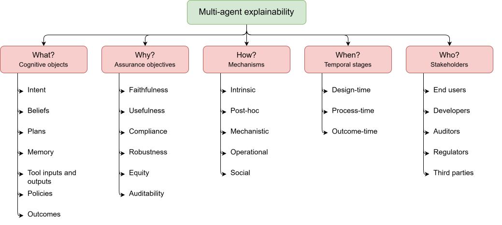

The extension of an LLM's isolated outputs into an LLM-based agent's extended decision trajectory demands a similar evolution towards more holistic Explainable AI. Although several taxonomies for single-agent system explainability exist in current literature, the motivations behind the definition of each dimensions fall out of scope for this work. Taxonomies that characterize agentic explainability based on human interaction (1), abstraction (2), or methodologies (3) can provide merit in their respective fields, but for the sake of practicality a "journalist" distinction of agentic explainability is used in this work, taking inspiration from (4). Namely, the five W's (with "Where" replaced with "How") provide a practical overview of the dimensions within the field of agent explainability. Although these dimensions may not be collectively exhaustive, there are practical advantages of approaching agentic xAI through this lens. Note that the larger scope of "transparency" is scoped down into "explainability" for this work.

Consider @fig-xmas-explainability-taxonomy, which illustrates the orthogonal distinctions within agentic explainability:

::: {style="text-align: center;"}
{#fig-xmas-explainability-taxonomy width=100%}
:::

- What: Cognitive objects are defined as the internal components that cause an agent's behaviour, including the intent, beliefs, plans, memory, tool inputs/outputs, policies, and outcomes.
- Why: Assurance objectives represent the objectives of explainability, including faithfulness, usefulness, compliance, robustness, equity, and auditability. In practical cases, explainability is not an end in and of itself, "rather an enabler of assurance" (4).
- How: Mechanisms represent the methods by which explainability is achieved, including intrinsic, post-hoc, mechanistic, operational, and social.
- When: Temporal stages define when explainability takes place, either design-time, process-time, and outcome-time.
- Who: Lastly, stakeholders are the users that require explainability. Raza et al. define five different categories, grounded on their typical use cases: end users, developers, auditors, regulators, and third parties.

Throughout this chapter, certain multi-agent explainability methods will be explored, typically expanding upon previously mentioned methods. Linear probes are logistic classifiers (as explored in section ??) trained on behavioural signals within streams in an LLM. Sparse autoencoders, as used in LLMs (cite earlier section), can be applied into a multi-agent context. Both methods represent a focus on low-level activation representations.  However, natural language based analysis provides an alternative to a focus on lower level representations of LLM-based agents. LLM-as-a-judge platforms such as Petri or LangSmith represent practical and scalable explainability methods, detecting signals within an LLMs message. Agent-level internal reasoning (chain-of-thought, ..., etc.) correspond to similar kinds of interpretability.  Exclusively multi-agent level explainability (that is, methods that are not extensions of LLM-based or agent-based methods) include visualizations that display architecures of communication, such as dynamic execution and communication graphs.

Consider the following figure, depicting the described methods on the previously mentioned taxonomy.

<!--
don't redefine the following:
    - linear probes, with agentic focus! don't re-explain logistic regression
    - llm-as-a-judge
    - saes, with agentic focus! don't re-explain concept
    - shap/lime

1 - https://ieeexplore.ieee.org/stamp/stamp.jsp?tp=&arnumber=11607607
2 - https://arxiv.org/pdf/2509.05199
3 - https://arxiv.org/pdf/2602.06841v4
4 - https://engrxiv.org/preprint/view/6451/10564
-->
